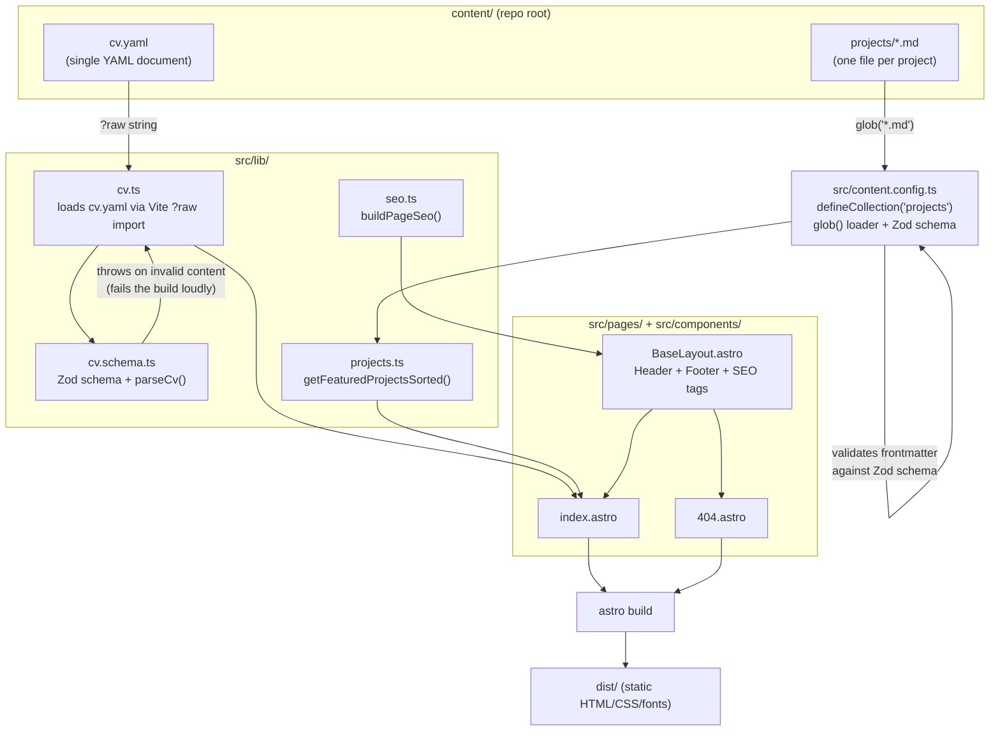

# Technical documentation

_Architecture, module responsibilities, configuration, runbook — for riauba.org as implemented
by spec 001 (site foundation and home page)._

!!! note "Scope"
    This describes what is built today: the static site skeleton and home page. The CV page
    and PDF (/cv, /cv/print), the projects listing and detail pages (/projects,
    /projects/&lt;slug&gt;) and the "How this site was built" page do **not** exist yet — the
    header links to them intentionally, and they currently 404. They land in specs 002–004.

## Architecture overview

riauba.org is a static site built with [Astro](https://astro.build) 7 (`output: "static"`,
see [Configuration](#configuration)). There is no server at request time: `astro build`
produces plain HTML/CSS/font files in `dist/`, which are served as-is (see
[Hosting](#runbook) below for how that happens in production).

Content is intentionally kept outside `src/` in a `content/` directory at the repository
root (per `CLAUDE.md`), and is loaded through two different, purpose-fit mechanisms —
documented and justified in
[ADR-0001](../adr/0001-content-loading-strategy.md).



Key properties of this build:

- **Fails loudly on bad content.** `src/lib/cv.schema.ts`'s `parseCv()` throws an `Error`
  listing every failing field path when `content/cv.yaml` doesn't match its Zod schema (e.g. a
  missing `basics.name`); Astro's content collection does the equivalent for
  `content/projects/*.md` against the schema in `src/content.config.ts`. Either failure stops
  `astro build` — there is no way to ship invalid content.
- **Zero client-side JavaScript on the home page.** Every page is a plain `.astro` component;
  no UI framework integration is installed (see `astro.config.mjs`).
- **Content lives outside `src/`.** `content/cv.yaml` is read as a raw string via Vite's `?raw`
  import suffix (not `node:fs` at runtime) specifically so the path resolves correctly
  regardless of where Astro's prerendering step bundles the importing module — see the comment
  in `src/lib/cv.ts` and ADR-0001 for why a `fs.readFileSync` + computed path does not work here.

## Module responsibilities

### `src/lib/`

| Module | Responsibility |
| --- | --- |
| `cv.schema.ts` | Zod schema (`cvSchema`) matching the shape of `content/cv.yaml`; `parseCv(data)` validates and throws a readable, multi-issue error on failure. Exports the inferred `Cv` and `Profile` types. |
| `cv.ts` | Loads `content/cv.yaml` (via a Vite `?raw` import, parsed with the `yaml` package) and validates it with `parseCv()` once at module load time, exporting the typed `cv` constant. Also exports `getVisibleProfiles(profiles)`, which filters out any profile whose `network` or `url` is the literal placeholder `"TODO"` (case- and whitespace-insensitive, so `"todo"` or `" TODO"` are also caught). |
| `projects.ts` | `getFeaturedProjectsSorted(entries)` — pure helper that filters a list of `projects` collection entries down to `featured: true` and sorts them by `order` ascending. |
| `seo.ts` | `buildPageSeo(site, { title, description, path })` — builds the `<title>`, meta description, canonical URL and Open Graph tag values for a page. `resolveCanonicalUrl` guarantees the canonical/OG URL always stays on the configured `site` origin (collapsing protocol-relative `//host` paths and stripping any foreign scheme/host from an absolute URL before resolving), throwing rather than ever emitting an off-site URL. No `og:image` is set yet. |

### `src/content.config.ts`

Defines the `projects` Astro content collection: a `glob()` loader with
`base: "./content/projects"` (resolved against the project root, not `src/`) and
`pattern: "*.md"`, validated against a Zod schema (`title`, `tagline`, `status`, `order`,
`featured`, `links.{live,docs,repo}`, `stack`). `status` is deliberately an open string, not a
closed enum — the four existing project files already use three different values (`"live"`,
`"active"`, `"case-study"`).

### `src/components/`

| Component | Responsibility |
| --- | --- |
| `BaseLayout.astro` | The shared HTML shell: `<head>` with charset/viewport/title/meta description/canonical/Open Graph tags (via `seo.ts`) and favicon, plus `Header`, a `<main>` slot, and `Footer`. Every page renders through this layout. |
| `Header.astro` | Site navigation: Home, Projects, CV, "How this site was built". The last three links are live today but point at pages that don't exist until specs 002–004 ship (they currently 404). |
| `Footer.astro` | Reads `cv.basics.email` and the visible LinkedIn profile (via `getVisibleProfiles`) to render a `mailto:` link and LinkedIn link, plus `© <current year> <cv.basics.name>`. |
| `ProjectCard.astro` | Renders one featured-project list item: a link to `/projects/<id>` (the collection entry's slug, derived by Astro from the markdown filename) with the project's `title`, and its `tagline`. |

### `src/pages/`

| Page | Responsibility |
| --- | --- |
| `index.astro` | The home page. Reads `cv` and `getVisibleProfiles` to render name/label/summary/remote line and profile links; reads the `projects` collection via `getCollection("projects")` and `getFeaturedProjectsSorted` to render featured projects in `order`. Builds its own short SEO description distinct from the full CV summary. |
| `404.astro` | A styled not-found page through the same `BaseLayout`, with a link back to `/`. |

### Styling and fonts

`src/styles/global.css` self-hosts Inter (OFL-licensed, `src/assets/fonts/*.woff2`) in two
subsets per weight (400/600): `latin` and `latin-ext`. `latin-ext` is required, not optional —
`content/cv.yaml` and `content/projects/*.md` contain Lithuanian diacritics (`ų`, `š`, `č`,
`ė`) that the `latin`-only subset doesn't cover. Colour theming uses CSS custom properties
switched by a `prefers-color-scheme: dark` media query; the dark-mode accent (`#60a5fa`) is a
lighter tint of the light-mode accent (`#1d4ed8`), chosen to keep WCAG AA contrast against the
dark background — verified by the axe accessibility e2e suite, not by a separate contrast
checker.

## Configuration

All build-time configuration lives in `astro.config.mjs`:

```js
export default defineConfig({
  site: "https://riauba.org",
  output: "static",
});
```

- `site` is the canonical origin used by `seo.ts`'s `buildPageSeo()` to build absolute
  canonical/Open Graph URLs; it is also what `resolveCanonicalUrl` enforces every page's
  canonical URL stays on.
- `output: "static"` — no server-side rendering, no adapter; `astro build` emits static files
  to `dist/`.

There are no environment variables consumed by the Astro build itself today. `make deploy` and
`make smoke` (see below) read deployment-time shell variables (`DEPLOY_USER`, `DEPLOY_HOST`,
`DEPLOY_PATH`, `ENV`), but actual deployment is out of scope until spec 004 — `make deploy`
exists in the `Makefile` already but there is nothing deploy-specific in the app code yet.

## API reference

There is no HTTP API and no OpenAPI spec — riauba.org is a static content site with no
backend. The closest things to a schema contract are the two content schemas documented above
(`src/lib/cv.schema.ts` and the `projectSchema` in `src/content.config.ts`), which fully define
the shape of `content/cv.yaml` and `content/projects/*.md`.

## Runbook

### Build, test and lint commands

Run from the repository root:

| Command | What it does |
| --- | --- |
| `make setup` | `npm ci`, then installs the Playwright Chromium browser. |
| `make test` | Runs Vitest unit tests (`tests/unit/`) against `src/lib/` and the content schemas. |
| `make lint` | `astro check` (TypeScript/Astro type checking) + `eslint` + `prettier --check`. |
| `make format` | `prettier --write .` |
| `make build` | `npm run build` (`astro build` → `dist/`) then `npm run build:pdf`. |
| `make e2e` | Runs `make build` first, then the Playwright e2e suite (`tests/e2e/`), including `@axe-core/playwright` accessibility scans. |
| `make screenshots` | Opt-in only — builds the site and regenerates `docs/user-guide/img/*.png` via a separate Playwright config (`playwright.screenshots.config.ts`). Not part of `make e2e` or CI because it overwrites tracked screenshots. |
| `make security` | `npm audit --audit-level=high`. |
| `make docs` | Builds this documentation site with `mkdocs build --strict` (fails on any warning). |

CI (`.github/workflows/ci.yml`) runs, on every pull request and push to `main`: `make setup`,
`make lint`, `make test`, `make security`, `make docs`, then `make e2e` (which depends on
`make build`), with the Playwright browser cache keyed on `package-lock.json`.

### The `build:pdf` stub

`npm run build:pdf` currently runs `scripts/build-pdf-stub.mjs`, which only logs a message and
exits 0. It exists purely so `make build` succeeds end-to-end before spec 002 (CV page and PDF)
lands; it does not generate `dist/andrius-r-cv.pdf`. Do not mistake it for the real PDF
generation step described in CLAUDE.md (Playwright printing `/cv/print`) — that route does not
exist yet.

### Common failures

- **Build fails with "Invalid content/cv.yaml: ... "** — `content/cv.yaml` doesn't match the
  schema in `src/lib/cv.schema.ts` (e.g. a required field is missing or has the wrong type).
  The error lists every failing field path; fix `content/cv.yaml` and rebuild.
- **Build fails with a content-collection schema error mentioning `content/projects/...`** —
  one of the markdown files' frontmatter doesn't match `projectSchema` in
  `src/content.config.ts` (e.g. `order` is a string instead of a number, or `featured` is
  missing). Fix the frontmatter and rebuild.
- **`make docs` fails with a strict mkdocs warning** — usually a broken internal link or a
  heading referenced by the nav that doesn't exist; `mkdocs build --strict` turns every warning
  into a build failure by design.
- **A nav link (Projects, CV, "How this site was built") 404s** — expected today; those pages
  don't exist until specs 002–004 ship.

### Adding a new project (developer-facing mechanics)

See the user guide's ["How to add a new
project"](../user-guide/index.md#how-to-add-a-new-project) for the content-authoring steps.
Mechanically: any new file dropped into `content/projects/*.md` with valid frontmatter is
picked up automatically by the `glob()` loader on the next build — no code change is needed to
register a new project.

There is no deploy or rollback runbook yet: hosting, deployment and rollback are spec 004's
scope (not built on this branch). `make deploy` and `make smoke` targets exist in the
`Makefile` already, in anticipation of that spec, but there is no deployment pipeline wired up
today.
