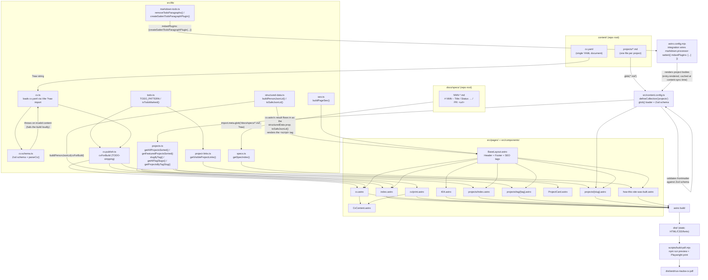

# Technical documentation

_Architecture, module responsibilities, configuration, runbook — for riauba.org as implemented
by spec 001 (site foundation and home page), spec 002 (CV page and PDF), spec 003 (projects
catalogue and detail pages), spec 004 (homelab hosting, staging and production deployment) and
spec 005 (visual design: tokens, theme toggle, fonts, visual regression testing)._

!!! note "Scope"
    This describes what is built today: the static site skeleton, home page, the CV page and
    downloadable PDF (`/cv`, `/cv/print`), the projects catalogue, tag filter and detail
    pages plus the "How this site was built" page (`/projects`, `/projects/tag/<tag>`,
    `/projects/<slug>`, `/how-this-site-was-built`), the AstroPaper-inspired visual theme
    with a persisted light/dark toggle covering every page, and real staging/production hosting
    on Andrius' homelab with automatic staging deploys, a manual gated production deploy and
    instant rollback. The full operational walkthrough (LXC setup, Cloudflare Tunnel hostnames,
    GitHub Environment configuration, first deploy, rollback, repository hardening) lives in the
    [deployment runbook](runbook.md), not here — this page covers the application-level pieces
    only: the `SITE_URL`/`NOINDEX` build variables and the `make smoke` command.

## Architecture overview

riauba.org is a static site built with [Astro](https://astro.build) 7 (`output: "static"`,
see [Configuration](#configuration)). There is no server at request time: `astro build`
produces plain HTML/CSS/font files in `dist/`, which are served as-is (see
[Hosting](#runbook) below for how that happens in production).

Content is intentionally kept outside `src/` in a `content/` directory at the repository
root (per `CLAUDE.md`), and is loaded through two different, purpose-fit mechanisms —
documented and justified in
[ADR-0001](../adr/0001-content-loading-strategy.md).



Key properties of this build:

- **Fails loudly on bad content.** `src/lib/cv.schema.ts`'s `parseCv()` throws an `Error`
  listing every failing field path when `content/cv.yaml` doesn't match its Zod schema (e.g. a
  missing `basics.name`); Astro's content collection does the equivalent for
  `content/projects/*.md` against the schema in `src/content.config.ts`. Either failure stops
  `astro build` — there is no way to ship invalid content.
- **Zero client-side JavaScript on the home page.** Every page is a plain `.astro` component;
  no UI framework integration is installed (see `astro.config.mjs`).
- **Content lives outside `src/`.** `content/cv.yaml` is read as a raw string via Vite's `?raw`
  import suffix (not `node:fs` at runtime) specifically so the path resolves correctly
  regardless of where Astro's prerendering step bundles the importing module — see the comment
  in `src/lib/cv.ts` and ADR-0001 for why a `fs.readFileSync` + computed path does not work here.

## Module responsibilities

### `src/lib/`

| Module | Responsibility |
| --- | --- |
| `cv.schema.ts` | Zod schema (`cvSchema`) matching the shape of `content/cv.yaml`; `parseCv(data)` validates and throws a readable, multi-issue error on failure. Exports the inferred `Cv`, `Profile` and `Work` types. |
| `cv.ts` | Loads `content/cv.yaml` (via a Vite `?raw` import, parsed with the `yaml` package) and validates it with `parseCv()` once at module load time, exporting the typed `cv` constant. Also exports `getWorkReverseChronological(work)`, which sorts work entries by `endDate` descending (an ongoing role with no `endDate` sorts as most recent), tie-broken by `startDate` descending. |
| `cv.publish.ts` | The site's TODO-filtering mechanism for `content/cv.yaml` (spec 002) — see [TODO filtering](#todo-filtering-cvpublishts) below. Exports `cvForBuild`, the one `Cv` value every page/component should import instead of the raw `cv` export from `cv.ts`. |
| `todo.ts` | Shared `TODO_PATTERN` (`/\bTODO\b/`, whole-word, case-sensitive) and `isTodoMarked(value)` helper (spec 003), extracted from `cv.publish.ts` so `project-links.ts` reuses the exact same matching rule. |
| `structured-data.ts` | `buildPersonJsonLd(cv)` maps `cv.basics` onto a [schema.org `Person`](https://schema.org/Person) object (name, jobTitle, email, url, address, `sameAs` profile URLs, description) for the `/cv` page's JSON-LD. `toSafeJsonLd(value)` serializes a value with `JSON.stringify` and escapes every literal `<` as `<` before it is injected into a `<script type="application/ld+json">` via `set:html`, so a CV field containing literal `<script>` text can never prematurely close the surrounding tag. |
| `projects.ts` | `getFeaturedProjectsSorted(entries)`/`getAllProjectsSorted(entries)` — pure helpers that sort `projects` collection entries by `order` ascending, filtered to `featured: true` or not filtered at all (spec 003, AC-1). `slugifyTag(tag)` lowercases a stack tag and collapses non-alphanumeric runs into single, trimmed hyphens. `getAllTagSlugs(entries)` groups every project under each of its tags' slug (AC-3) and **throws** a readable error — rather than silently merging — if two distinct tag labels slugify to the same non-empty slug, or if a label slugifies to the empty string. `getProjectsByTagSlug(entries, slug)` filters to projects whose `stack` includes a tag matching that slug. |
| `project-links.ts` | `getVisibleProjectLinks(links)` (spec 003, AC-4) — returns the ordered (live, docs, repo) link buttons a project detail page should render, dropping any value that is `null` or TODO-marked (via `todo.ts`'s `isTodoMarked`). **Unconditional**: identical in `astro dev` and `astro build`, unlike `markdown-todo.ts` below — a link button that literally read "TODO" would otherwise be visible (and clickable, pointing nowhere useful) in local dev. |
| `markdown-todo.ts` | TODO-*paragraph* stripping for `content/projects/*.md` bodies (spec 003, AC-5) — see [Markdown body TODO stripping](#markdown-body-todo-stripping-markdown-todots) below. |
| `specs.ts` | `getSpecIndex()` (spec 003, AC-6) — reads every `docs/specs/<NNN>-*.md` file (excluding `*.plan.md`/`*.log.md`/`_TEMPLATE.md`) via a Vite `import.meta.glob` raw import, parsing `{ number, title, status, pr? }` from each file's `# NNN – Title` / `Status: ...` / optional `PR: <url>` header lines, sorted ascending by number. Throws a readable error if a file has no parseable heading/status line, or if its filename's leading number disagrees with its own heading's. |
| `seo.ts` | `buildPageSeo(site, { title, description, path })` — builds the `<title>`, meta description, canonical URL and Open Graph tag values for a page. `resolveCanonicalUrl` guarantees the canonical/OG URL always stays on the configured `site` origin (collapsing protocol-relative `//host` paths and stripping any foreign scheme/host from an absolute URL before resolving), throwing rather than ever emitting an off-site URL. No `og:image` is set yet. |

**Two different TODO-handling code paths exist side by side**, and deliberately share no code:
`cv.publish.ts`'s whole-*field*, schema-aware stripping for `content/cv.yaml` (a typed object
tree, filtered at page-render time) and `markdown-todo.ts`'s whole-*paragraph*, mdast-aware
stripping for `content/projects/*.md` bodies (a markdown AST, filtered at content-sync time) —
see [Markdown body TODO stripping](#markdown-body-todo-stripping-markdown-todots) and
[ADR-0003](../adr/0003-project-body-todo-stripping.md) for why these can't share a single
implementation. `project-links.ts`'s link-button filter is a third, much smaller TODO check
(a single string equality/pattern test, no tree at all) that is unconditional rather than
prod-build-only — see its row above.

### TODO filtering (`cv.publish.ts`)

Every page and component that reads CV data imports `cvForBuild` from `src/lib/cv.publish.ts`
— never the raw `cv` export from `cv.ts` directly — so there is exactly one place in the
codebase that decides whether a `"TODO"`-marked placeholder in `content/cv.yaml` is visible.
This replaces spec 001's `getVisibleProfiles(profiles)` helper (removed), which only filtered
`basics.profiles` for the home page and footer; `cv.publish.ts` filters the *entire* CV tree
(profiles, work entries, highlights, education, languages, certificates — anything) and is
now also what the home page uses for its profile list, not a separate mechanism.

Behaviour:

- **Outside production builds** (`import.meta.env.PROD` is `false`, i.e. `astro dev` and
  `astro build --mode development`), `cvForBuild` is identical to the raw, unfiltered `cv` —
  every TODO placeholder renders as-is everywhere a page reads `cvForBuild`, including the
  home page. (Before spec 002, the home page additionally hid TODO profiles during local dev
  too; that special case is gone; dev now behaves the same as every other page.)
- **In production builds** (`npm run build` / `astro build`), `getPublishableCv` calls
  `stripTodoFields(cv)`, which deep-clones the parsed `Cv` and removes every field whose
  string value matches the whole-word, case-sensitive pattern `/\bTODO\b/` — so a literal
  word `TODO` anywhere, including inside a longer sentence like `"TODO: confirm start date"`,
  matches, but `"todo"` (lowercase), padded variants like `" TODO "`, and a mid-word substring
  such as `"Kristodoras"` do not. This is a deliberate narrowing from spec 001's
  case-insensitive, whitespace-trimmed substring match.
- `findTodoFields` recursively walks the cloned tree and returns the dot-path of every
  matching string leaf (array indices appear as numeric segments, e.g. `"work.0.endDate"`).
  `classifyTodoPath` then consults the Zod *shape* of `cvSchema` (not the data) to decide what
  stripping a given path means. **Why schema-aware rather than one blanket rule:** a single
  fixed policy is wrong in both directions. Always deleting just the field would publish a
  `Work` entry missing a *required* field (e.g. a TODO `position` but a real `name` and dates),
  silently shipping a half-filled record every downstream consumer (`CvContent.astro`, the PDF,
  the JSON-LD) assumes is complete. Always dropping the whole containing record instead would
  over-delete: a TODO in an *optional* field like `work[].endDate` (an ongoing role simply
  hasn't ended yet) or a single still-TODO item inside a plain string array like `highlights`
  would needlessly destroy an otherwise-complete, already-written work entry along with it.
  Consulting the schema's required/optional shape per field lets the stripper pick the
  narrowest removal that is still safe to publish for each case:
  - the path's last segment is an index into a plain string array (`highlights`, `skills.*.keywords`)
    → remove just that array element;
  - the path resolves to an **optional** object field (anything accepting `undefined`, checked
    via `fieldSchema.safeParse(undefined).success` rather than the deprecated `.isOptional()`)
    → delete just that field;
  - the path resolves to a **required** object field → drop the whole enclosing object from
    its containing array (a profile/work/education/language entry disappears entirely rather
    than being published half-filled).
  - a required field with **no** containing array to drop from (e.g. `basics.name` lives
    directly on the top-level `basics` object) is a deliberate hard failure, not a silent
    null-out: `stripTodoFields` throws, naming the exact field path, per this project's
    "fail loudly" convention — nulling `basics` would otherwise crash every downstream
    consumer with a cryptic `TypeError` instead of a clear message.
- Every path actually stripped is reported once via `console.warn`, listing all stripped
  dot-paths, so a production build that silently drops content is still visible in the build
  log.

### Markdown body TODO stripping (`markdown-todo.ts`)

Spec 003's AC-5 requires that any top-level paragraph in a `content/projects/*.md` body
starting with the literal word `TODO` is omitted from the production build, with a build
warning — the same marker and whole-word/case-sensitive rule as `cv.publish.ts`, but applied to
a markdown AST instead of a parsed JS object tree, because by the time a page could mutate an
entry's raw body, Astro has already rendered it to cached HTML — see
[ADR-0003](../adr/0003-project-body-todo-stripping.md) for the full reasoning.

- `removeTodoParagraphs(tree)` walks an mdast root's *direct* children only; for each top-level
  `paragraph` it computes the **recursively-joined plain text** (concatenating every descendant
  text node's `.value`, depth-first, across all inline children — so a leading `**TODO**` bold
  run is caught, not just a bare leading text node) and removes the paragraph if that text
  matches `/^TODO\b/`. A TODO paragraph nested inside a list item or blockquote is left
  untouched — a documented limitation, not a bug (see ADR-0003's Consequences).
- `remarkStripTodoParagraphs({ enabled, warn })` wraps that in the classic unified/remark
  "attacher" shape the mechanism was originally designed around.
- **The real build wiring doesn't use that classic shape**, because Astro 7.4 (the version this
  repo pins) ships **Sätteri**, not the classic `unified`/`remark` pipeline, as its *default*
  Markdown processor, and `markdown.remarkPlugins` throws a config-validation error unless the
  separate `@astrojs/markdown-remark` package is installed too — confirmed by actually running
  `astro build` with it configured (see ADR-0003's Addendum). Production wiring instead goes
  through `createSatteriTodoParagraphPlugin`, targeting Sätteri's own native mdast-plugin shape:
  a `before(root, context)` hook (run once per document, before Sätteri's own visitors) that
  removes each matching top-level paragraph via `context.removeNode(node)` (Sätteri's tree is
  read-only from plugin code; there is no `tree.children` array to reassign).
- `astro.config.mjs` registers the stripping via a small inline integration's `astro:config:setup`
  hook (`markdown.processor: satteri({ mdastPlugins: [createSatteriTodoParagraphPlugin({ enabled:
  command === "build", warn: () => {} }) ] })`), **not** a functional
  `defineConfig(({ command }) => ({ ... }))` default export — Astro's own `defineConfig` is a
  plain identity function and never calls a function passed as the config's default export
  (also confirmed empirically; see ADR-0003's Addendum). TODOs render as-is in `astro dev`, are
  stripped in `astro build`, mirroring `cv.publish.ts`'s `import.meta.env.PROD` gating via the
  config-time `command` equivalent.
- **The build warning is emitted from a separate, cache-independent path, not from the Sätteri
  plugin above.** Astro's content-layer glob loader skips re-rendering a file (and therefore
  skips re-invoking the Sätteri plugin's `before` hook) whenever the file's on-disk content
  digest is unchanged since the last sync — correct for reusing already-rendered HTML, but wrong
  for a side-effecting warning: a second `astro build` in a row against an unchanged, warm
  content-layer cache would otherwise never warn again, even though the (still correctly
  stripped) output is unchanged. So `createSatteriTodoParagraphPlugin`'s own `warn` is wired as a
  no-op in production, and the same integration also hooks `astro:build:start` — which Astro
  calls unconditionally, once per `astro build`, before any content-layer sync happens — to call
  `warnAboutTodoParagraphsInFiles`, which scans `content/projects/*.md` directly off disk and
  counts top-level TODO paragraphs via `countTopLevelTodoParagraphsInMarkdownBody`. That counter
  parses each file's body with `satteri`'s own `markdownToMdast` (the same native mdast parser
  Astro's `satteri()` processor uses) and runs the result through `createSatteriTodoParagraphPlugin`
  itself — the literal same plugin that performs the real stripping — reading back its count via
  an `onRemoved` callback. There is exactly one piece of logic deciding "is this a top-level TODO
  paragraph"; the warning and the actual stripped output cannot disagree. (An earlier version of
  this counter was a bespoke, dependency-free text-level block splitter, independent of mdast —
  it disagreed with the real plugin on a loose-list lazy continuation and a setext heading, a bug
  found in review 2 and fixed by this mdast-based rewrite.) This fires on every build, cold or
  warm cache alike; see ADR-0003's Addendum for the investigation.

### `src/content.config.ts`

Defines the `projects` Astro content collection: a `glob()` loader with
`base: "./content/projects"` (resolved against the project root, not `src/`) and
`pattern: "*.md"`, validated against a Zod schema (`title`, `tagline`, `status`, `order`,
`featured`, `links.{live,docs,repo}`, `stack`). `status` is deliberately an open string, not a
closed enum — the four existing project files already use three different values (`"live"`,
`"active"`, `"case-study"`).

### `src/components/`

| Component | Responsibility |
| --- | --- |
| `BaseLayout.astro` | The shared HTML shell: `<head>` with charset/viewport/title/meta description/canonical/Open Graph tags (via `seo.ts`) and favicon, plus `Header`, a `<main>` slot, and `Footer`. Every page renders through this layout. |
| `Header.astro` | Site navigation: Home, Projects, CV, "How this site was built", and a direct "Download CV (PDF)" link to `/andrius-riauba-cv.pdf`. Every link is live. |
| `Footer.astro` | Reads `cvForBuild.basics.email` and the LinkedIn profile (found by matching `network` case-insensitively, after TODO-filtering has already run) to render a `mailto:` link and LinkedIn link, plus `© <current year> <cvForBuild.basics.name>`. |
| `CvContent.astro` | Renders the full CV body (name/label/contact line/profiles/remote line, Summary, Experience, Skills, Education, Languages, Certificates — each section only shown when its underlying list/string is non-empty) from a `Cv` passed in as a prop. Shared, unstyled-by-page-chrome markup used identically by both `/cv` (inside `BaseLayout`) and `/cv/print` (standalone, for the PDF), so the two can never drift apart. Work entries are pre-sorted by the caller via `getWorkReverseChronological`. |
| `ProjectCard.astro` | Renders one project list item (used by the home page's featured list, `/projects` and `/projects/tag/<tag>`): a link to `/projects/<id>`, the `title`, a generic status badge (`project.data.status`, one visual style regardless of the status string), the `tagline`, and each `stack` entry as a link to `/projects/tag/<slugifyTag(tag)>` (spec 003, AC-1/AC-3). |

### `src/pages/`

| Page | Responsibility |
| --- | --- |
| `index.astro` | The home page. Reads `cvForBuild` to render name/label/summary/remote line and profile links (TODO-filtered per `cv.publish.ts`); reads the `projects` collection via `getCollection("projects")` and `getFeaturedProjectsSorted` to render featured projects in `order`. Builds its own short SEO description distinct from the full CV summary. |
| `cv.astro` | The `/cv` page. Renders a "Download CV (PDF)" button linking to `/andrius-riauba-cv.pdf`, then `<CvContent cv={cvForBuild} />`, through the normal `BaseLayout` (full header/footer/nav). Also passes `buildPersonJsonLd(cvForBuild)` to `BaseLayout` as `structuredData`, which serializes it into a `<script type="application/ld+json">` tag via `toSafeJsonLd`. |
| `cv/print.astro` | The print-optimised source for the generated PDF (spec 002, decision #4): a minimal standalone HTML document — no `Header`/`Footer`/nav — rendering the same `<CvContent cv={cvForBuild} />`, with `<meta name="robots" content="noindex">` and a `<link rel="canonical">` pointing back at `/cv` so it is never indexed as a separate page. Imports `src/styles/print.css` in addition to the shared `global.css` for print-specific layout (e.g. page-break control). This is the exact URL `scripts/build-pdf.mjs` loads and prints to PDF; it is not meant to be browsed directly. |
| `projects/index.astro` | The `/projects` catalogue page (spec 003, AC-1): every project from `getCollection("projects")`, sorted via `getAllProjectsSorted`, rendered as `ProjectCard`s. |
| `projects/tag/[tag].astro` | Static `/projects/tag/<tag>` filter pages (spec 003, AC-3): `getStaticPaths()` generates one page per `getAllTagSlugs()` group (`{ slug, label, projects }`), rendering only that group's projects — filtering needs zero client-side JavaScript. |
| `projects/[slug].astro` | The `/projects/<slug>` detail page (spec 003, AC-4/AC-5): `getStaticPaths()` from every collection entry; renders the markdown body via `astro:content`'s `render(entry)` (already TODO-paragraph-stripped in production, per `markdown-todo.ts`), plus a link button per `getVisibleProjectLinks(project.data.links)` entry. |
| `how-this-site-was-built.astro` | The `/how-this-site-was-built` page (spec 003, AC-6): hand-written prose on the spec→plan→implement→test→review→docs pipeline and its two human approval gates, plus a table built from `getSpecIndex()` (number, title, status, PR link when present). |
| `404.astro` | A styled not-found page through the same `BaseLayout`, with a link back to `/`. |

### Styling and fonts (spec 005 — visual design)

`src/styles/tokens.css` is the **single source of truth** for every colour, radius and font
token used anywhere in the site. `global.css` `@import`s it first. `tests/unit/
no-hardcoded-colors.test.ts` enforces this mechanically: it scans every `src/**/*.css` file and
every `<style>` block in `src/**/*.astro` for hex, `rgb()`/`rgba()`, `hsl()` and `oklch()`
colour literals and fails the build if any appear outside `tokens.css`.

**Theme resolution order** (lowest to highest precedence, by source order — same specificity,
later wins, no `!important` needed anywhere):

1. `:root` — light-theme defaults (`--color-accent: #1d4ed8`).
2. `@media (prefers-color-scheme: dark)` — the system preference, overriding `:root` when the
   OS/browser reports a dark preference and nothing else has overridden it yet. The dark accent
   is a distinct, lighter-tuned variant of the light accent's hue (`#7fb0ff`), not a reuse of
   `#1d4ed8` on a dark background — tuned for WCAG AA contrast (`tests/e2e/
   accessibility.spec.ts`).
3. `[data-theme="light"]` / `[data-theme="dark"]` — a manual override, declared after the media
   query above so a deliberate choice always beats the system preference. Set by the two inline
   scripts below via `document.documentElement.dataset.theme`, alongside the CSS
   `color-scheme` property so native form controls/scrollbars follow the active theme too.

**The two inline `<script is:inline>` tags are the only client-side JavaScript shipped
anywhere on the site**, a deliberate, narrow exception to "zero client JS by default"
(`CLAUDE.md`) — a flash-free, persisted manual theme override is not achievable with CSS
alone. Each wraps every `localStorage` access in `try`/`catch` (private-browsing/
storage-disabled contexts throw on *access*, not just on write). Their final, shipped
responsibilities are deliberately split and asymmetric:

- **`BaseLayout.astro`'s head script** runs synchronously, immediately after `<meta charset>`,
  before any stylesheet paints. It reads `localStorage.getItem("theme")` and, **only if** a
  stored value is exactly `"light"` or `"dark"`, sets `dataset.theme` and `style.colorScheme` to
  it. If nothing is stored, it does nothing at all — the `prefers-color-scheme` media query in
  `tokens.css` already handles that case on its own. This is what prevents a flash of the wrong
  theme on reload for a visitor who has made an explicit choice.
- **`Header.astro`'s toggle script** attaches the click handler for the toggle `<button>`
  (hidden by default via `[hidden]` in the base stylesheet, revealed only once the listener is
  attached, so it never renders as an apparently-functional control before JS has run). On
  **page load**, it only calls a small `updateButton()` helper that reflects the current
  effective theme (read from `dataset.theme` if already set by the head script, else
  `matchMedia("(prefers-color-scheme: dark)")`) onto the button's own `aria-pressed`/icon — it
  deliberately does **not** pin `dataset.theme`/`style.colorScheme` on load. Only the **click**
  handler runs the full `applyTheme()` flow: flip to the opposite theme, persist it to
  `localStorage`, set `dataset.theme`/`style.colorScheme`, then update the button. This split
  exists to fix a real bug found in review: an earlier version called the full pin-and-persist
  flow on every page load regardless of whether anything was stored, which froze
  `dataset.theme` to whatever the OS preference happened to be at first paint and broke live
  `prefers-color-scheme` repaints for the rest of that page view for a visitor who had never
  touched the toggle. See `docs/specs/005-visual-design.log.md` for the fix.
- **If a Content-Security-Policy is ever added**, both inline scripts will need a `sha256-`
  hash (or a nonce) in the `script-src` directive — `unsafe-inline` would defeat the point of
  adding a CSP in the first place. No CSP exists today; this is a forward-looking note for
  whoever adds one.

**Fonts** are self-hosted (OFL-1.1), never loaded from a CDN or system font stack:

- **Inter** — weights 400 and 600, each in two subsets, `latin` and `latin-ext`. `latin-ext` is
  required, not optional: `content/cv.yaml` and `content/projects/*.md` contain Lithuanian
  diacritics (`ų`, `š`, `č`, `ė`) the `latin`-only subset doesn't cover. Only the 400-weight
  `latin`/`latin-ext` files (the above-the-fold body text font) are preloaded via `<link
  rel="preload" as="font">` in `BaseLayout.astro`'s `<head>` — the imported font URLs (not
  hard-coded strings) so the `href`s always match Vite's content-hashed output filenames. Inter
  600 (headings) is deliberately **not** preloaded, since it's below the fold on most pages.
- **JetBrains Mono** — weight 400, `latin` + `latin-ext` subsets, self-hosted the same way, for
  `code`/`pre`. Added pre-emptively: no current `content/projects/*.md` file uses inline code or
  code blocks, so it has no visible effect yet, but this keeps "no system/CDN font for *any*
  rendered text" true immediately once a future write-up does use `code`/`pre`. **Not
  preloaded** — zero bytes requested on any page without `code`/`pre`.
- Licensing for both families is recorded in `THIRD_PARTY_NOTICES.md` at the repo root, which
  also scopes exactly what was ported from AstroPaper (MIT) — design-token structure/naming and
  page-layout/component visual patterns only, no source code or build tooling.

**Visual regression testing.** A dedicated Playwright suite, `tests/visual/pages.spec.ts`
(config: `playwright.visual.config.ts`, `testDir: "tests/visual"`), takes `toHaveScreenshot()`
baselines of `/`, `/cv`, `/projects`, a project detail page, a tag page, `/how-this-site-was-
built` and `/404` in both light and dark themes, plus `/` and `/cv` at 360px width in light
theme only — 16 baselines in total — each awaiting `page.evaluate(() => document.fonts.ready)`
before capturing. This is a separate suite from the pre-existing `tests/screenshots/`
documentation-screenshot capture (opt-in, overwrites `docs/user-guide/img/*.png`, asserts
nothing about pixel content) — two distinct purposes, no overlap.

Because font anti-aliasing/hinting differs across host OSes and would otherwise produce
spurious pixel diffs unrelated to any real regression, this suite is designed to run **only**
inside the official, version-pinned `mcr.microsoft.com/playwright` Docker image — never on a
bare host. `make visual` (asserts against committed baselines) and `make visual-update`
(regenerates them with `--update-snapshots`, the *only* supported way to change a baseline PNG)
both wrap the test run in `docker run --user $(id -u):$(id -g) --ipc=host` against that image;
the image tag's version segment is kept in lockstep with the installed `@playwright/test`
version by `tests/unit/playwright-docker-version.test.ts`. The same image is used natively in
CI via `.github/workflows/ci.yml`'s `visual` job (`jobs.visual.container.image`, no Docker
daemon needed there). See [ADR-0004](../adr/0004-visual-regression-docker.md) for the full
rationale and alternatives considered.

**Known open item, honestly flagged: no baseline PNGs are committed yet.** Neither the
implementing nor the testing session for spec 005 had local Docker access, so
`tests/visual/pages.spec.ts-snapshots/` is currently empty. Without baselines, every run of the
suite fails with a missing-snapshot error rather than a real comparison — so the CI `visual` job
currently has `continue-on-error: true` set, with an inline comment explaining why, and is
**not yet a blocking gate**. The job (and this note) should be revisited — remove
`continue-on-error` from `.github/workflows/ci.yml` — once someone with local Docker access
runs `make visual-update` and commits the resulting baseline PNGs.

## Configuration

All build-time configuration lives in `astro.config.mjs`:

```js
export default defineConfig({
  site: "https://riauba.org",
  output: "static",
  integrations: [todoParagraphStrippingIntegration()],
});
```

- `site` is the canonical origin used by `seo.ts`'s `buildPageSeo()` to build absolute
  canonical/Open Graph URLs; it is also what `resolveCanonicalUrl` enforces every page's
  canonical URL stays on.
- `output: "static"` — no server-side rendering, no adapter; `astro build` emits static files
  to `dist/`.
- `integrations: [todoParagraphStrippingIntegration()]` — a small inline integration (spec 003,
  not a separate npm package) whose `astro:config:setup` hook sets `markdown.processor:
  satteri({ mdastPlugins: [createSatteriTodoParagraphPlugin({ enabled: command === "build",
  warn: () => {} }) ] })`, gating AC-5's TODO-paragraph stripping on the real CLI command. The
  Sätteri plugin's own `warn` is a no-op in production — the `astro:build:start` hook (see
  [Markdown body TODO stripping](#markdown-body-todo-stripping-markdown-todots) below) is the
  sole source of the AC-5 build warning. This is an inline integration, rather than the plain
  object/functional forms `defineConfig` might suggest, because Astro's `defineConfig` never
  invokes a function passed as its default export — `astro:config:setup` is the documented way
  to read `command` — see
  [Markdown body TODO stripping](#markdown-body-todo-stripping-markdown-todots) and
  [ADR-0003](../adr/0003-project-body-todo-stripping.md)'s Addendum.

Two environment variables drive the Astro build itself (spec 004):

- `SITE_URL` — the absolute origin `astro.config.mjs`'s `siteUrlIntegration` resolves via
  `src/lib/site-url.ts`'s `resolveSiteUrl()`. Required (missing or empty both throw) for
  `astro build`; the `Makefile`'s `build` target defaults it to `https://riauba.org` only when
  truly unset, so a GitHub Environment variable that exists but was left empty still reaches
  `resolveSiteUrl()` as `""` and fails the build loudly instead of silently substituting the
  default. Every other Astro command (`dev`, `preview`, `check`, `sync`) falls back to
  `http://localhost:4321` when unset. The deploy workflows set it per environment from each
  GitHub Environment's `SITE_URL` variable (`vars.SITE_URL`) — see the
  [deployment runbook](runbook.md).
- `NOINDEX` — read as `import.meta.env.NOINDEX === "true"` by `src/pages/robots.txt.ts`
  (`src/lib/robots.ts`'s `buildRobotsTxt()`) to decide between `Disallow: /` and `Allow: /`, and
  by `astro.config.mjs`'s `noindexSentinelIntegration` to write an empty `dist/.noindex` sentinel
  file that `infra/Caddyfile`'s `@noindex file .noindex` matcher turns into an
  `X-Robots-Tag: noindex, nofollow` response header for whichever release is currently deployed —
  so the header and `/robots.txt` can never disagree within one release. Unset locally (`make
  build`/`make e2e` never set it, so both default to indexable); the deploy workflows set it to
  `"true"` for staging always, and for production from the `PROD_NOINDEX` Environment variable
  (`"false"` now that the runbook's "Switch to riauba.org" checklist is complete — production is
  indexable; falls back to `"true"` if the variable is ever unset).

`make smoke ENV=<staging|production> [SHA=<sha>]` (see [Runbook](#runbook) below) reads
`STAGING_URL`/`PROD_URL` (falling back to `https://riauba.org`/`https://staging.riauba.org` —
the temporary `*.riaubyne.eu` hostnames from spec 004's initial rollout are retired) and, when
given, compares the deployed `/version.txt` against `SHA` — it is a verification command, not a
build-time one, and consumes no variables that affect the Astro build itself.

## API reference

There is no HTTP API and no OpenAPI spec — riauba.org is a static content site with no
backend. The closest things to a schema contract are the two content schemas documented above
(`src/lib/cv.schema.ts` and the `projectSchema` in `src/content.config.ts`), which fully define
the shape of `content/cv.yaml` and `content/projects/*.md`.

## Runbook

### Build, test and lint commands

Run from the repository root:

| Command | What it does |
| --- | --- |
| `make setup` | `npm ci`, then installs the Playwright Chromium browser. |
| `make test` | Runs Vitest unit tests (`tests/unit/`) against `src/lib/` and the content schemas. |
| `make lint` | `astro check` (TypeScript/Astro type checking) + `eslint` + `prettier --check`, plus a syntax-only `bash -n` check of the three `infra/*.sh` scripts (full `shellcheck` runs only in CI). |
| `make format` | `prettier --write .` |
| `make build` | `npm run build` (`astro build` → `dist/`, with `SITE_URL` defaulted to `https://riauba.org` only when truly unset — see [Configuration](#configuration)) then `npm run build:pdf`. |
| `make e2e` | Runs `make build` first, then the Playwright e2e suite (`tests/e2e/`), including `@axe-core/playwright` accessibility scans. |
| `make screenshots` | Opt-in only — builds the site and regenerates `docs/user-guide/img/*.png` via a separate Playwright config (`playwright.screenshots.config.ts`). Not part of `make e2e` or CI because it overwrites tracked screenshots. |
| `make visual` | Opt-in, requires Docker — builds the site, then runs the `tests/visual/` screenshot-regression suite against committed baselines, inside the pinned `mcr.microsoft.com/playwright` Docker image (see [Styling and fonts](#styling-and-fonts-spec-005-visual-design)). Not part of `make e2e`; `make setup` does not install Docker. |
| `make visual-update` | Same as `make visual`, with `--update-snapshots`. The *only* supported way to change a `tests/visual/` baseline PNG — never run on a bare host. |
| `make security` | `npm audit --audit-level=high`. |
| `make docs` | Builds this documentation site with `mkdocs build --strict` (fails on any warning). `SITE_DIR` overrides the output directory (defaults to `site`); the deploy workflows set `SITE_DIR=dist/docs` so this ships inside the same build artifact, under `/docs/`. |
| `make smoke ENV=<staging\|production> [SHA=<sha>]` | Verifies a deployed environment: checks `/`, `/cv`, `/projects`, the CV PDF and `/docs/` all return 200, optionally compares `/version.txt` to `SHA`, and for `ENV=staging` additionally requires the `X-Robots-Tag: noindex, nofollow` header. Not run locally in the normal dev loop — used by the deploy workflows and manually against a live environment. See the [deployment runbook](runbook.md). |

CI (`.github/workflows/ci.yml`) runs, on every pull request and push to `main`: `make setup`,
`make lint`, `make test`, `make security`, `make docs`, then `make e2e` (which depends on
`make build`), with the Playwright browser cache keyed on `package-lock.json`. A separate
`visual` job runs the same `tests/visual/` suite natively inside the pinned Playwright Docker
image (GitHub Actions' `container:` key); it currently has `continue-on-error: true` set since
no baseline PNGs are committed yet — see the note at the end of [Styling and
fonts](#styling-and-fonts-spec-005-visual-design) above.

### The `build:pdf` step

`npm run build:pdf` runs `scripts/build-pdf.mjs`, which generates the real, downloadable
`dist/andrius-riauba-cv.pdf` by printing the `/cv/print` route with a headless Chromium driven
by `playwright-core`. It replaces spec 001's no-op stub (`scripts/build-pdf-stub.mjs`, deleted).
Full rationale and alternatives considered are in
[ADR-0002](../adr/0002-pdf-generation-approach.md); the mechanics:

1. `astro build` only produces static files in `dist/` — nothing serves them over HTTP, and
   `page.goto()` needs a URL. So the script first spawns the project's own `npm run preview`
   as a child process on a dedicated port (`4323`, distinct from the e2e suite's `4321` so the
   two never collide even run back to back).
2. It polls that server with `fetch` every 250ms until it responds, with a bounded 30s
   timeout. Per this project's "fail loudly" convention, a server that never becomes ready
   throws a descriptive error and exits non-zero rather than hanging `make build` forever.
3. Once ready, it launches `chromium` (from `playwright-core`, pinned to the same version as
   the `playwright`/`@playwright/test` dependency already used by the e2e suite — see ADR-0002
   decision 2), navigates to `/cv/print`, waits for `document.fonts.ready` so printed text
   isn't rendered with a fallback font, and calls `page.pdf({ path: "dist/andrius-riauba-cv.pdf",
   format: "A4", printBackground: true })`.
4. The preview server and browser are always torn down in a `finally` block, regardless of
   whether printing succeeded. The server is started with `detached: true`, making it the
   leader of its own OS process group, and is stopped by signalling that whole group
   (`process.kill(-pid, "SIGTERM")`, falling back to `SIGKILL` after a 5s grace period) rather
   than just the immediate child PID. This is deliberately more than a plain `child.kill()`:
   manual QA surfaced that killing only the immediate `npm` process could leave the actual
   `astro preview` process it had spawned running and holding port 4323, because some npm
   versions replace the immediate child via `exec()` into a different process rather than
   keeping it around as the thing that owns the listening socket — a plain, non-group kill
   then has nothing left to signal, and the server survives to orphan the next run. Killing
   the negative PID (the whole process group) reaches it either way.

### Common failures

- **Build fails with "Invalid content/cv.yaml: ... "** — `content/cv.yaml` doesn't match the
  schema in `src/lib/cv.schema.ts` (e.g. a required field is missing or has the wrong type).
  The error lists every failing field path; fix `content/cv.yaml` and rebuild.
- **Build fails with a content-collection schema error mentioning `content/projects/...`** —
  one of the markdown files' frontmatter doesn't match `projectSchema` in
  `src/content.config.ts` (e.g. `order` is a string instead of a number, or `featured` is
  missing). Fix the frontmatter and rebuild.
- **`make docs` fails with a strict mkdocs warning** — usually a broken internal link or a
  heading referenced by the nav that doesn't exist; `mkdocs build --strict` turns every warning
  into a build failure by design.
- **Build fails with `getAllTagSlugs: tags "..." and "..." both slugify to "..."`** — two
  distinct stack tags across `content/projects/*.md` collapse to the same `/projects/tag/<slug>`
  route (e.g. two spellings of the same technology). Rename one of them so they slugify
  differently.
- **Build fails with `getAllTagSlugs: tag "..." ... slugifies to an empty string`** — a stack
  tag is made up entirely of non-alphanumeric characters (e.g. just punctuation), so it has no
  usable route segment. Rename the tag to include at least one letter or digit.
- **`build:pdf` fails with "preview server ... did not become ready within 30000ms"** —
  something is already bound to port 4323 (a leftover `astro preview` process from a prior
  interrupted `build-pdf.mjs` run is the usual cause), or `astro build` didn't run first so
  `dist/` is missing/stale. Free the port (or reboot the shell) and rerun `make build`.

### Adding a new project (developer-facing mechanics)

See the user guide's ["How to add a new
project"](../user-guide/index.md#how-to-add-a-new-project) for the content-authoring steps.
Mechanically: any new file dropped into `content/projects/*.md` with valid frontmatter is
picked up automatically by the `glob()` loader on the next build — no code change is needed to
register a new project.

### Deploy and rollback

Deployment itself has no local `make deploy` equivalent any more — the old rsync/SSH target is
gone. Every real deploy and rollback runs from `infra/deploy.sh`/`infra/rollback.sh` on the
self-hosted `homelab-riauba` GitHub Actions runner, triggered by `deploy-staging.yml` (automatic,
on every push to `main`), `deploy-production.yml` (manual, `confirm=deploy`) or
`deploy-rollback.yml` (manual, no rebuild). `make smoke ENV=<env> [SHA=<sha>]` (above) is the
verification step those workflows run afterwards.

The full operational walkthrough — provisioning the homelab LXC, registering the runner, the
Cloudflare Tunnel hostnames, GitHub Environment configuration, first deploy, rollback, viewing
logs, the "Switch to riauba.org" checklist and the one-time repository hardening settings — lives
in the [deployment runbook](runbook.md), not here.
