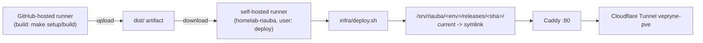

# Deployment runbook (spec 004)

This is the step-by-step manual runbook for Andrius: everything needed to stand up staging and
production hosting on the homelab, run the first deploy, roll back, and later switch production
over to the real `riauba.org` domain. None of this runs in CI — the self-hosted runner, the LXC
itself and Caddy never execute inside this repository's test suite (see
[Architecture overview](#architecture-overview) below and `docs/specs/004-deployment.plan.md`'s
"Risks" section for why). Everything here is performed by Andrius, by hand, following this page.

!!! note "Scope"
    This page covers spec 004 (homelab hosting, staging and production deployment) only. For the
    application-level architecture, module responsibilities and local build/test commands, see
    [Technical documentation](index.md).

## Architecture overview



- **Build** always happens on a GitHub-hosted runner (`ubuntu-latest`) — Playwright/Chromium is
  never installed on the homelab.
- **Deploy** jobs run on the self-hosted `homelab-riauba` runner inside the portfolio LXC. The
  runner connects outbound to GitHub only; no SSH keys, open inbound ports or deploy secrets
  exist anywhere in this setup.
- **Releases** are immutable, SHA-named directories; `current` is a symlink switched atomically
  by `infra/deploy.sh`/`infra/rollback.sh`. See those scripts' own header comments and
  `docs/specs/004-deployment.plan.md`'s "Resolved decisions" for the append-only
  `releases.log`-driven pruning/rollback order.
- **TLS** terminates at Cloudflare; Caddy (`infra/Caddyfile`) only ever speaks plain HTTP inside
  the LAN, behind the existing Cloudflare Tunnel (`vepryne-pve`) also used by other homelab
  services.

## 1. Create the portfolio LXC in Proxmox

1. In the Proxmox web UI, create a new **unprivileged** LXC container from a Debian 12 (or
   newer) template.
2. Resources: 1 vCPU, 1 GB RAM, 8 GB disk — the spec's non-functional requirement; the site is a
   handful of static files plus a lightweight Caddy process and the runner binary.
3. Give it a static IP (or a DHCP reservation) on the homelab LAN, consistent with how the other
   homelab LXCs (e.g. Nginx Proxy Manager on LXC 100) are configured.
4. Proxmox firewall rules on this LXC:
   - Inbound: only from the host(s) that front the Cloudflare Tunnel / reverse proxy (never
     directly from the internet — there is no public inbound port on this LXC at all).
   - Outbound: internet allowed (the runner needs to reach `github.com`/`*.actions.githubusercontent.com`,
     and `apt`/Caddy's install step needs to reach its package repository).
   - No LAN-to-LAN access to other homelab hosts beyond what's required above — the spec's
     non-functional requirement that a compromised portfolio LXC can't pivot to the rest of the
     homelab.
5. Boot the LXC and note its ID (e.g. 105) for your own records.

## 2. Run `infra/setup-lxc.sh`

Inside the LXC, as root (a fresh Debian template doesn't ship `git` by default, and the GitHub
Actions runner needs it too, for `actions/checkout` in every workflow run):

```sh
apt-get update && apt-get install -y git
git clone https://github.com/<owner>/riauba-portfolio.git /tmp/riauba-portfolio
cd /tmp/riauba-portfolio
./infra/setup-lxc.sh
```

This idempotent script (safe to run again any time, e.g. after a `Caddyfile` change) creates the
unprivileged `deploy` system user, `/srv/riauba/{staging,production}/releases` owned by it,
installs Caddy from its official apt repository, installs `infra/Caddyfile` to
`/etc/caddy/Caddyfile` and reloads it, then prints the exact commands for the next step.

## 3. Register the GitHub Actions runner

Follow the commands `infra/setup-lxc.sh` just printed — summarised here:

1. On GitHub: repository **Settings → Actions → Runners → New self-hosted runner**, copy the
   one-time registration token shown there.
2. As the `deploy` user on the LXC, download and configure the runner with
   `--labels homelab-riauba` and a recognisable `--name` (e.g. `portfolio-lxc`).
3. Install and start it as a systemd service (`./svc.sh install deploy && ./svc.sh start`) so it
   survives a reboot and always runs as `deploy`, never root.
4. Confirm it shows up as **Idle** under Settings → Actions → Runners before continuing.

## 4. Add the two Cloudflare Tunnel public hostnames

Following the existing `vepryne-pve` tunnel's routing pattern (same tunnel already used by other
homelab services), add two public hostnames pointing at this LXC's Caddy (port 80):

| Public hostname | Service (tunnel target) |
| --- | --- |
| `portfolio.riaubyne.eu` | `http://<portfolio-lxc-ip>:80` |
| `portfolio-staging.riaubyne.eu` | `http://<portfolio-lxc-ip>:80` |

Both temporary hostnames point at the *same* Caddy instance — `infra/Caddyfile`'s two site
blocks (addressed by `PROD_HOSTS`/`STAGING_HOSTS`) tell it apart by the `Host` header, routing
each to its own environment's `current` directory.

## 5. Set the GitHub Environment variables

In the GitHub repository's **Settings → Environments**, configure both `staging` and
`production` (create them if they don't exist yet) with these **Environment variables** (not
secrets — none are needed):

| Environment | `SITE_URL` | `PROD_NOINDEX` | `PROD_HOSTS` / `STAGING_HOSTS` |
| --- | --- | --- | --- |
| `staging` | `https://portfolio-staging.riaubyne.eu` | n/a | `STAGING_HOSTS=portfolio-staging.riaubyne.eu` (set once on the LXC, see below) |
| `production` | `https://portfolio.riaubyne.eu` | `true` | `PROD_HOSTS=portfolio.riaubyne.eu` (set once on the LXC, see below) |

`SITE_URL` and `PROD_NOINDEX` are read by the deploy workflows (`vars.SITE_URL`,
`vars.PROD_NOINDEX`) and passed to `make build`. `PROD_HOSTS`/`STAGING_HOSTS` are **not** GitHub
Environment variables — they're plain environment variables exported wherever Caddy itself runs
(e.g. in `/etc/default/caddy` or the systemd unit's `Environment=` on the LXC), since only Caddy
reads them (see `infra/Caddyfile`).

## 6. First deploy

1. Merge a change to `main` (or just push to `main` once this spec itself is merged) —
   `deploy-staging.yml` runs automatically: build (GitHub-hosted) → artifact → `infra/deploy.sh
   staging <sha>` (homelab-riauba) → `make smoke ENV=staging`.
2. Watch the workflow run in the **Actions** tab. The `deploy` job only runs if
   `github.actor == github.repository_owner` — a safety gate so only Andrius' own pushes can
   ever reach the homelab runner.
3. Confirm with `curl -I https://portfolio-staging.riaubyne.eu/` (or just open it in a browser)
   and check the `X-Robots-Tag: noindex, nofollow` header is present.
4. For production: **Actions → deploy-production → Run workflow**, type `deploy` into the
   `confirm` input, leave `ref` empty (defaults to the sha currently live on staging). Watch
   `resolve-ref` → `build` → `deploy` run in order.

## 7. Rollback

**Actions → deploy-rollback → Run workflow**, choose `env` (`staging` or `production`), leave
`sha` empty to roll back to the previous release, or supply an exact sha to roll back to a
specific one. This repoints `current` only — no rebuild, so it completes in well under the
spec's 10-second budget. See `infra/rollback.sh`'s own header comment for exactly how "previous
release" is computed from `releases.log` (never directory `mtime`).

## 8. Viewing logs

On the LXC:

```sh
journalctl -u caddy -f               # Caddy's own request/error logs
journalctl -u actions.runner.* -f    # the GitHub Actions runner service
```

`/srv/riauba/<env>/releases.log` is the append-only history of every deploy/rollback for that
environment; `/srv/riauba/<env>/DEPLOYED` always holds the sha and UTC timestamp of the release
`current` points at right now.

## "Switch to riauba.org" checklist

Spec 004's third user story: moving production from the temporary `portfolio.riaubyne.eu`
hostname to the real `riauba.org` domain must be a configuration change only, never a code
change.

1. Add the `riauba.org` domain to the Cloudflare account (Cloudflare dashboard → Add a site),
   and point its nameservers at Cloudflare per Cloudflare's own onboarding instructions.
2. Add two new Cloudflare Tunnel public hostnames, same pattern as step 4 above:
   `riauba.org` and `staging.riauba.org` → the portfolio LXC's Caddy. Also add `www.riauba.org`
   as a redirect to `riauba.org` (Cloudflare's own redirect rules, not Caddy).
3. Update `PROD_HOSTS` (on the LXC, where Caddy reads it) to include `riauba.org` — Caddy's
   site-address list is comma-separated, so this can be `riauba.org,portfolio.riaubyne.eu` during
   a transition period, or just `riauba.org` once the temporary hostname is retired. Update
   `STAGING_HOSTS` similarly to include `staging.riauba.org`.
4. Update the `production` GitHub Environment's `SITE_URL` variable to `https://riauba.org`
   (and `staging`'s to `https://staging.riauba.org`).
5. Set the `production` Environment's `PROD_NOINDEX` variable to `false` — production is now
   meant to be indexed by search engines.
6. Redeploy production (**Actions → deploy-production → Run workflow**, `confirm=deploy`) so the
   next build picks up the new `SITE_URL` (canonical/OG URLs) and `PROD_NOINDEX=false` (the
   `dist/.noindex` sentinel is no longer written, so Caddy stops sending the noindex header).
7. Verify: `make smoke ENV=production` (with `PROD_URL=https://riauba.org` exported locally, or
   just `curl -I https://riauba.org/`) — confirm `X-Robots-Tag` is **absent**, `/robots.txt`
   now says `Allow: /`, and the canonical URL in the page source reads `https://riauba.org/...`.

## Repository hardening

Beyond the application/deploy-workflow scope above, Andrius applies the following one-time
GitHub repository settings himself — none of this is expressible in a workflow YAML file, and
Claude/CI must never change repository settings on Andrius' behalf.

### Main-branch ruleset

**Settings → Rules → Rulesets → New branch ruleset**, targeting `main`:

- Require a pull request before merging.
- Require the `ci` status check to pass before merging.
- Require 1 approval, and require review from a code owner (see CODEOWNERS below).
- Block force pushes.
- Restrict who can bypass this ruleset: administrators may bypass only the "pull request
  required" rule (e.g. for an emergency direct commit), **never** the status-check or
  force-push-protection rules.

### Actions settings

**Settings → Actions → General**:

- "Require approval for first-time contributors" / **"Require approval for all outside
  collaborators"** for fork pull request workflows, so a fork PR's workflow run (e.g.
  `claude-review`) never executes unattended.
- Workflow permissions: default `GITHUB_TOKEN` permissions set to **read-only**.
- **"Actions cannot approve pull requests"** — prevents a workflow from ever satisfying the
  ruleset's own approval requirement on its own.

### Environment protection

**Settings → Environments**, for both `staging` and `production`:

- Deployment branches: limited to `main` only (neither environment can be deployed from any
  other branch or an arbitrary ref — `deploy-production.yml`'s `resolve-ref` job additionally
  enforces this at the commit level, but the environment-level restriction is a second,
  independent layer).
- `production` additionally requires a **reviewer** (`@asas1313`) to approve before any job
  using `environment: production` runs — this is what turns `deploy-production.yml`'s and
  `deploy-rollback.yml`'s production-targeting jobs (`environment: production` in their YAML)
  into an actual human approval gate, not just a label.

### CODEOWNERS

`.github/CODEOWNERS` (committed, see the repository root) names `@asas1313` as the owner of
every path (`* @asas1313`), so the branch ruleset's "require review from a code owner" rule
always has someone to request review from.

### `riauba-bot`: the runner's OS-level service account

**`riauba-bot` is not a GitHub identity, and it never reviews anything.** The human reviewer for
both the branch ruleset's code-owner requirement and the `production` environment's required
reviewer is `@asas1313` (Andrius' own GitHub account, named in `.github/CODEOWNERS` and in the
Environment protection setting above) — that's deliberate: approving a production deploy or a
pull request is a decision only Andrius himself makes, never automation.

`riauba-bot` is the name of the **unprivileged Linux system user** that `infra/setup-lxc.sh`
creates on the portfolio LXC (step 2 above calls this account `deploy` in the actual script and
systemd service — `riauba-bot` is just a more memorable name for the same account if you choose
to rename it). It is the OS-level account the GitHub Actions runner process and every
`infra/deploy.sh`/`infra/rollback.sh` invocation run as — never root, and never tied to any
GitHub account at all:

- **Why a dedicated OS user:** the runner process and the files it writes
  (`/srv/riauba/<env>/releases/...`) should never run as root, and should be isolated from any
  other service that might later run on the same LXC. If this account is ever compromised, blast
  radius is limited to `/srv/riauba` and the runner's own working directory.
- **No GitHub token at all:** the self-hosted runner authenticates its own outbound connection to
  GitHub using the short-lived, single-use registration token from step 3 above (fetched by
  Andrius from Settings → Actions → Runners), not a long-lived personal access token. Nothing on
  the LXC — this OS user included — ever holds a GitHub credential of any kind, which is exactly
  why the deploy workflows in this spec need no secrets.
