# User guide

This guide is for Andrius: how to update the content of riauba.org without touching any code.
Everything on the site today comes from two places in the repository:

- `content/cv.yaml` — your CV: name, role, summary, work history, skills, education, languages
  and profile links.
- `content/projects/*.md` — one file per project shown on the home page.

!!! note "What's live today"
    The site has a home page, a full CV page with a downloadable PDF, a projects catalogue with
    tag filtering, a project detail page per project, a "How this site was built" page, and a
    styled 404 page — all in a professional light/dark theme with a toggle in the header (see
    ["How to switch between light and dark mode"](#how-to-switch-between-light-and-dark-mode)
    below).

## How to update the home page content

The home page (screenshots below) shows your name, role, a one-line summary, your remote-work
preference, your profile links, and your featured projects.

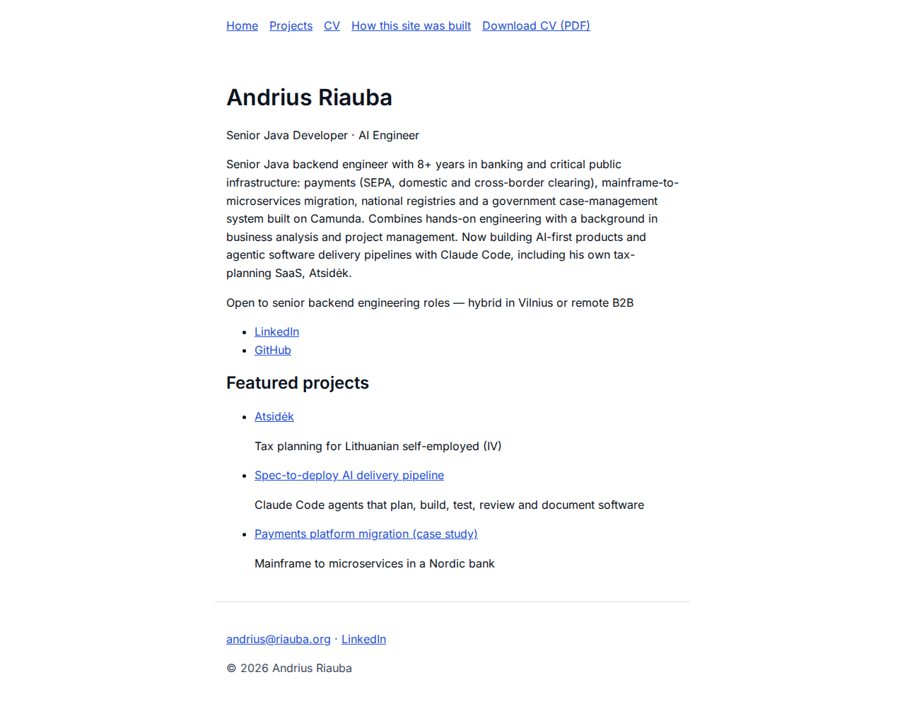

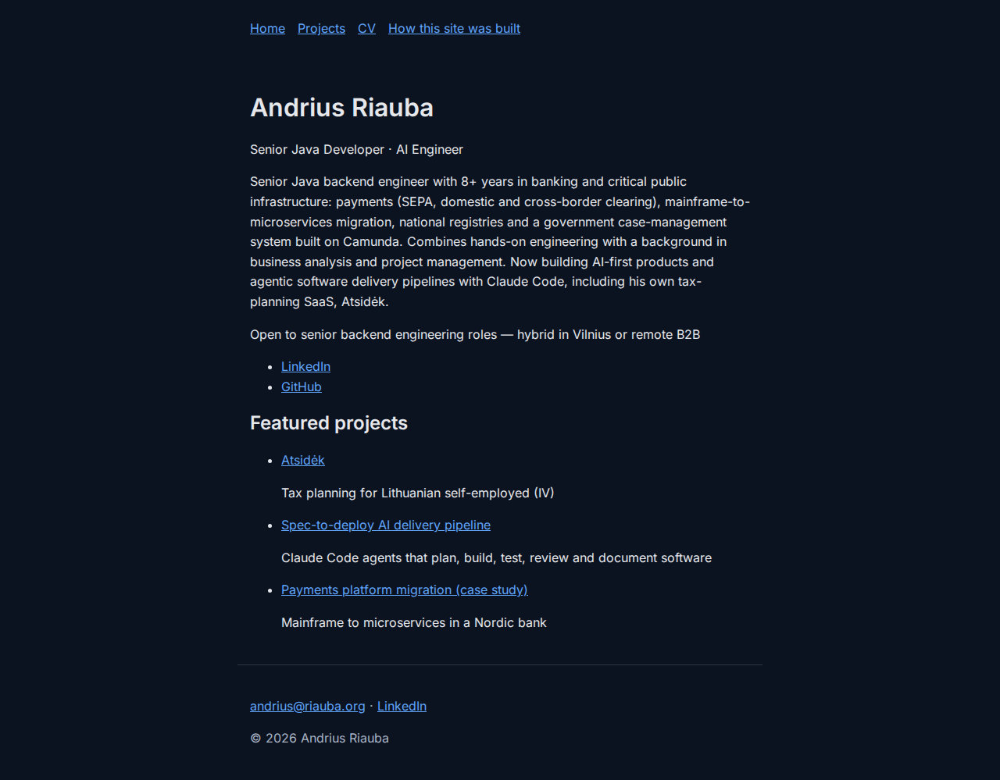

To change what it shows:

1. Open `content/cv.yaml` in a text editor.
2. Edit the fields under `basics:`:
   - `name` — your displayed name.
   - `label` — the short role line shown under your name (e.g. "Senior Java Developer · AI
     Engineer").
   - `summary` — the paragraph shown on the home page. It's written as a YAML "folded" block
     (the `>` after `summary:`), so you can wrap it across multiple indented lines in the file
     and it will still render as one paragraph.
   - `remote` — the one-line sentence about what kind of role/remote setup you're open to.
   - `email` — used to build the "email me" link in the footer.
3. Save the file and rebuild the site (`make build`) to see your changes, or run `make e2e` to
   also check nothing broke.

There is no need to touch any `.astro` file to change this text — the home page always reads
it fresh from `content/cv.yaml` at build time.

### How the TODO placeholder rule works

Under `basics.profiles:` you list your social/professional links, for example:

```yaml
profiles:
  - { network: "LinkedIn", url: "https://www.linkedin.com/in/andrius-r" }
  - { network: "GitHub", url: "https://github.com/asas1313" }
```

Any profile is shown as a link on the home page, on the CV page, and (for LinkedIn
specifically) in the footer — **unless** its `network` or `url` value contains the literal
placeholder word `TODO`. That entry is then automatically hidden from the published site, so
it's safe to leave a placeholder row in `content/cv.yaml` for a profile you haven't set up yet
(e.g. a future "Mastodon" or "X" link) without it appearing broken on the live site. This same
TODO rule applies to every field across the whole CV, not just profiles: any work entry,
education entry, language, skill keyword or highlight containing a `TODO` placeholder is
stripped in the same way before the site is published.

The match is **case-sensitive and whole-word**: the literal word `TODO`, in capitals, matched
as a whole word. That means:

- `"TODO"` and `"TODO: ask about dates"` are both hidden — a whole word `TODO` anywhere in the
  text matches, even inside a longer sentence.
- `"todo"` (lowercase) is **not** hidden — it's published as-is. Always type the placeholder in
  capitals: `TODO`.
- A word that merely contains "todo" as a substring, like a hypothetical `"Kristodoras"`, is
  **not** hidden either, since it isn't a standalone word.
- Any other real text, even a typo, is treated as a real value and published as-is.
  Double-check the exact URL before you save.

To publish a link, just replace the `TODO` placeholder with the real URL (and make sure
`network` has the real platform name) and rebuild.

One more thing worth knowing: this TODO-stripping only happens in a **production build**
(`make build` / `make e2e`, and the live site). When you run the dev server (`npm run dev`),
every `TODO` placeholder renders exactly as written, everywhere — including the home page.
This makes it easy to spot unfinished content locally; it's only hidden once you actually
build for production.

### What happens if you make a typo in cv.yaml

`content/cv.yaml` has a strict structure. If you remove a required field (for example delete
the `name:` line entirely) or put the wrong kind of value in a field, the site will refuse to
build: `make build` fails with an error message listing exactly which field is wrong and why,
instead of silently publishing a broken page. Fix the field mentioned in the error and build
again.

## The CV page and PDF

The `/cv` page (linked from the header as "CV") shows your full CV — contact details, profile
links, summary, work history, skills, education, languages and certificates — mirroring
`content/cv.yaml` exactly, section by section. There's nothing to configure beyond editing that
one file: anything you change there (following the sections above, plus work/skills/education/
languages, which follow the same pattern) shows up on `/cv` after the next build.

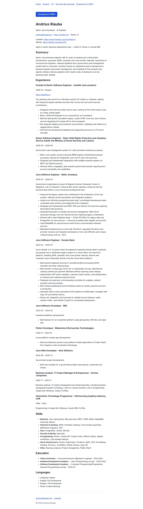

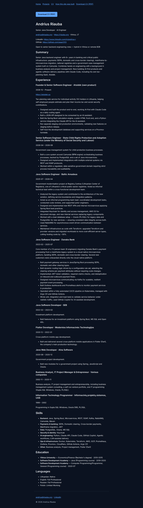

At the top of the page there's a "Download CV (PDF)" button, which links straight to
`/andrius-riauba-cv.pdf` — a PDF generated automatically at build time from the same CV
content, so it's always in sync with the page; there's no separate PDF file to maintain by
hand. The same download link also appears directly in the site header, next to "CV".

That PDF is produced by printing a second, print-optimised page, `/cv/print`, shown below:

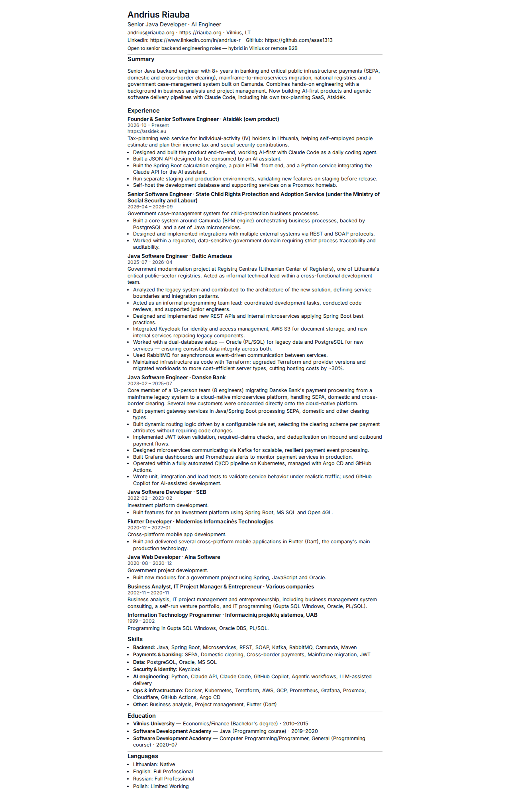

You won't normally visit `/cv/print` yourself — it has no header or footer, isn't meant to be
browsed, and is marked `noindex` (with its canonical link pointing back at `/cv`) so search
engines never treat it as a separate page. It exists purely as the exact page the automated PDF
build prints; the content on it is identical to `/cv`, just without the surrounding site
chrome.

## How this site was built

The "How this site was built" page (linked from the header) is a short, factual explanation of
the spec → plan → implement → test → review → docs process used to build this site, with a
table listing every spec (number, title, status, and a link to its merged pull request where
one exists). There's nothing to author here yourself — it's generated from `docs/specs/` at
build time, not from `content/`.

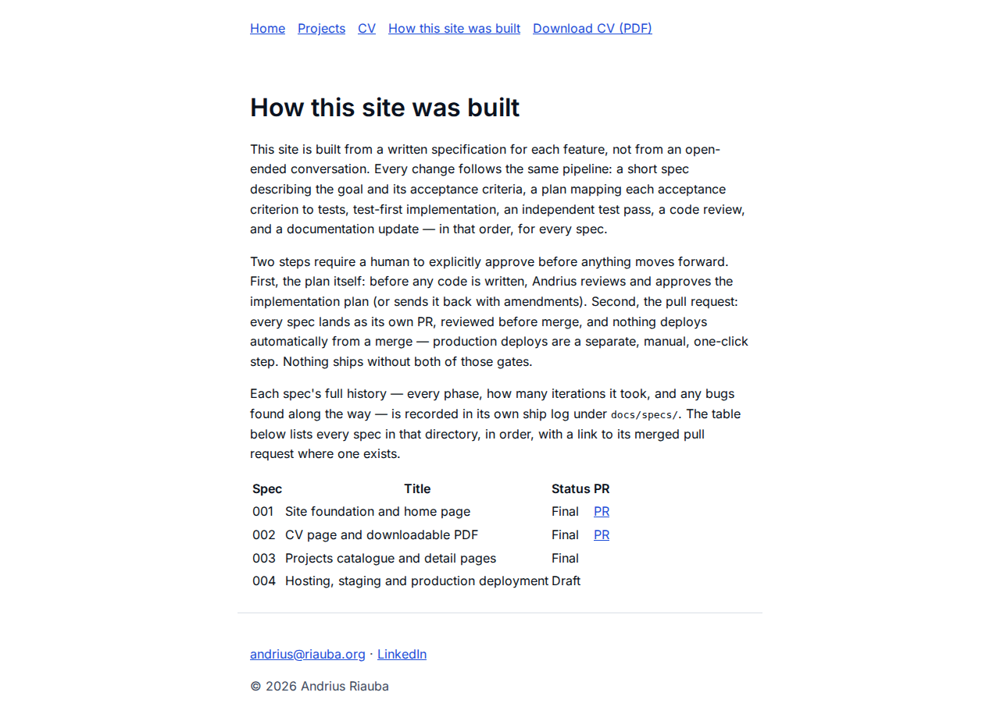

## How to add a new project

Featured projects (`featured: true`) appear on the home page. Every project, featured or not,
appears on the `/projects` catalogue page (linked from the header as "Projects") and gets its
own `/projects/<slug>` detail page.

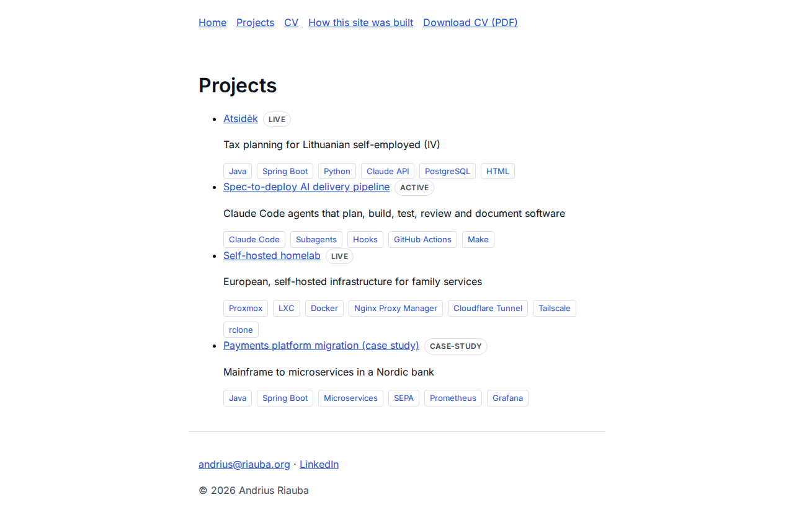

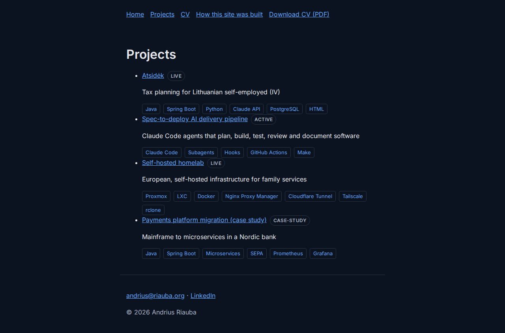

Each project links through to its own detail page:

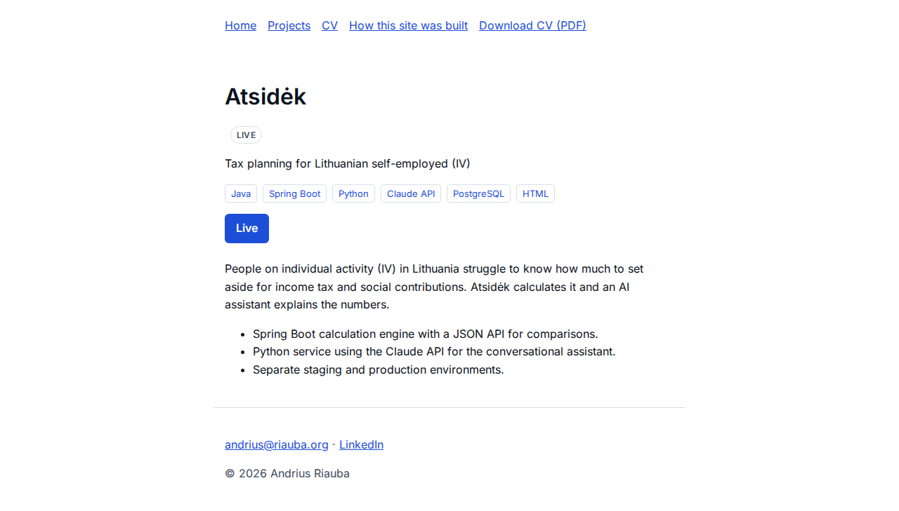

Every `stack` entry is also a tag linking to a page listing every project sharing that tag:

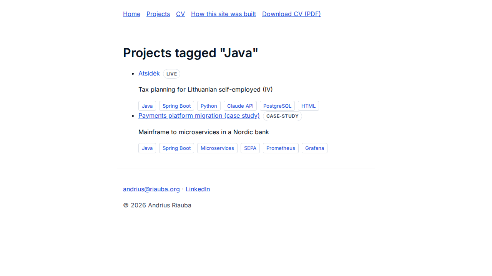

To add a new project:

1. Create a new file in `content/projects/`, named after the project using lowercase letters
   and hyphens, e.g. `content/projects/my-new-project.md`. This filename becomes the project's
   URL slug (so this example would be reachable at `/projects/my-new-project`).
2. Give it frontmatter like this (copy an existing file in that folder as a starting point,
   e.g. `content/projects/atsidek.md`):

   ```markdown
   ---
   title: "My New Project"
   tagline: "One short sentence describing it"
   status: "live"
   order: 5
   featured: true
   links: { live: "https://example.com", docs: null, repo: null }
   stack: ["Java", "Spring Boot"]
   ---
   A short description of the project goes here, in normal markdown.
   ```

   Field notes:
   - `title` — the project name shown everywhere the project appears.
   - `tagline` — the one-line description shown under the title.
   - `status` — a free-text status word, shown as a badge; the existing projects use `"live"`,
     `"active"` and `"case-study"`, but any short word works — there's no fixed list, and every
     status gets the same badge style.
   - `order` — a number controlling where it appears, both among featured projects on the home
     page and in the full `/projects` list (lower numbers first).
   - `featured` — set to `true` to also show it on the home page, `false` to keep it out of the
     home page (it still appears on `/projects`).
   - `links` — set `live`, `docs` and/or `repo` to a URL to show a button for that link on the
     project's detail page, or leave as `null` (or the placeholder `"TODO"`) to hide that
     button. Hiding a `TODO` link button happens immediately, in both `make build` and the dev
     server — unlike the body-text rule below, there's no "only in production" exception for
     link buttons.
   - `stack` — a list of technology names. Each one is shown as a tag linking to
     `/projects/tag/<tag>`, a page listing every project that shares that tag — this needs no
     JavaScript, it's a plain static page per tag. Two different tag spellings that would end
     up looking the same in a URL (e.g. differing only in punctuation) make the build fail with
     a clear error naming both — rename one of them so they're distinguishable.
3. Below the frontmatter, write the project's description in normal markdown — paragraphs,
   lists, links, whatever you need. This becomes the body of the project's `/projects/<slug>`
   page.
4. Save the file and rebuild (`make build`). No code changes are needed — any `.md` file in
   `content/projects/` with valid frontmatter is picked up automatically.

If the frontmatter is missing a required field or has the wrong type (e.g. `order` written as
text instead of a number), the build fails with a clear error naming the problem, the same way
it does for `cv.yaml`.

### Leaving a TODO note in a project's body text

The same `TODO` placeholder convention from `cv.yaml` (see ["How the TODO placeholder rule
works"](#how-the-todo-placeholder-rule-works) above) also applies to a **whole paragraph** in a
project's markdown body: write a paragraph starting with the word `TODO` (e.g. `TODO (Andrius):
fill in the hardest technical problem here.`) as a placeholder reminder for yourself, and it is
automatically left out of the published page — only in a production build (`make build` /
`make e2e`, and the live site); it renders exactly as written in the dev server (`npm run dev`),
so you can still see your own reminder locally. Only a paragraph whose text *starts with* `TODO`
is removed this way; a paragraph that merely mentions "TODO" partway through stays published.
This check only looks at top-level paragraphs, not text inside a bullet list or a blockquote —
put reminders in their own paragraph, not inside a list item.

## How to switch between light and dark mode

Every page has a small sun/moon toggle button in the header, next to the navigation links.
Click it to switch between light and dark mode — the whole page repaints immediately, no
reload needed.

Your choice is remembered: it's saved in your browser's `localStorage`, so the next time you
visit (even in a new tab or after closing the browser), the site opens in the mode you last
chose. If you've never clicked the toggle, the site instead follows your operating system's
light/dark setting automatically, and keeps following it live if you change that OS setting
while the page is open.

!!! note "For contributors: updating the visual-regression screenshots"
    Separately from the `docs/user-guide/img/*.png` screenshots shown throughout this guide,
    the project also keeps a set of pixel-comparison "baseline" screenshots
    (`tests/visual/pages.spec.ts-snapshots/`) used to catch accidental visual regressions.
    These must only ever be generated with `make visual-update`, which runs inside a
    version-pinned Docker image — never by running the test suite directly on your own
    machine. A baseline generated on a bare host renders fonts slightly differently from one
    machine to the next and would produce false failures for everyone else. See
    [Styling and fonts](../technical/index.md#styling-and-fonts-spec-005-visual-design) in the
    technical docs for details, including the current status of this suite in CI.

## The 404 page

If you (or a visitor) follow a broken link, the site shows a styled "page not found" message
with a link back to the home page, instead of a blank browser error:

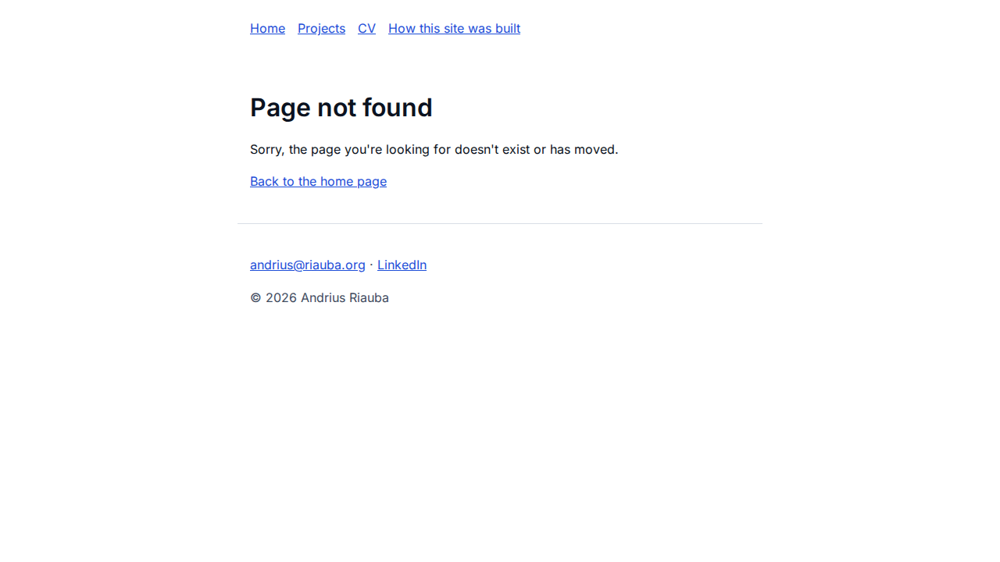
